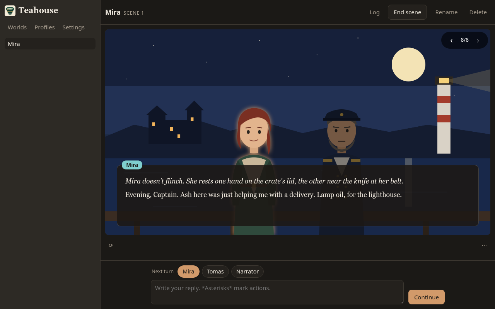

<p align="center"></p>

<h1 align="center">Teahouse</h1>

<p align="center"><strong>AI roleplay in the style of a visual novel, with a world that remembers.</strong></p>

<p align="center"></p>

You play scenes with characters on your own server, against the model of your choice. When a scene ends, Teahouse proposes what the world should remember: who met whom, what was promised, what changed. You decide what stays. The world lives as plain Markdown files in a Git repository, so you can read it, edit it in any editor, and undo any change.

> [!NOTE]
> Teahouse is in early development. The latest release is [0.4.1](https://github.com/Linyeir/teahouse/releases/tag/v0.4.1); the [changelog](CHANGELOG.md) says what changed.

## What makes it different

- **Scenes, not one endless chat.** You end a scene yourself. What happened in it goes into the world's files after you've checked it, instead of fading out of a long chat log.
- **A world you own.** Characters, places, lore and past events are Markdown files with a full history. Teahouse proposes changes; you accept, edit or reject each one.
- **A visual novel view.** Backgrounds, character images by mood, one character per turn, and you pick who speaks next.
- **Your server, your devices.** Runs against LM Studio, llama.cpp, OpenRouter or any OpenAI-compatible endpoint. The web client, desktop and Android apps sync through your server and work offline.

## Quickstart

You need Docker and an LLM endpoint: LM Studio or llama.cpp on your machine, or an OpenRouter key.

1. Save this as `compose.yaml` in an empty folder, and run `docker compose up -d` there:

   ```yaml
   services:
     teahouse:
       image: ghcr.io/linyeir/teahouse:latest
       ports:
         - "8787:8787"
       volumes:
         - teahouse-data:/data
       # Lets the container reach LM Studio or llama.cpp on this machine (needed on Linux).
       extra_hosts:
         - "host.docker.internal:host-gateway"
       restart: unless-stopped

   volumes:
     teahouse-data:
   ```

2. Open http://localhost:8787 and choose a password.
3. Under **Profiles**, add a profile: pick a preset, enter the model (or **Load models**) and, for OpenRouter, the API key. For LM Studio or llama.cpp on the same machine, use `http://host.docker.internal:1234/v1` or `:8080/v1`, because inside Docker `localhost` is the container itself.
4. Under **Worlds**, **Import character card** (PNG or JSON, V1 to V3), or create a **New world** and add a character.
5. Pick a greeting, **Start chat**, and write your first line.

When the scene is over, press **End scene** and choose **with canon**. Teahouse shows what it would add to the world, file by file, and you decide.

> [!WARNING]
> Teahouse speaks plain HTTP. Before other devices reach it over a network you don't fully trust, read [Running the server](docs/server.md).

## Learn more

| | |
|---|---|
| [How Teahouse works](docs/how-it-works.md) | Scenes, turns, memory, and how the world learns from what you play |
| [Worlds](docs/worlds.md) | The files of a world, aliases, images, editing in Obsidian, export |
| [Running the server](docs/server.md) | Docker, models and profiles, updates, backups, configuration |
| [Apps and devices](docs/apps.md) | Desktop and Android apps, pairing a phone, offline play |
| [Coming from SillyTavern](docs/sillytavern.md) | What carries over, and what works differently |
| [HTTPS](docs/https.md) · [Theming](docs/theming.md) | Certificates for your devices; colors and fonts of the view |
| [The concept](docs/concept.md) | Design decisions and where the project is going |

Building from source, tests and releases are in [CONTRIBUTING.md](CONTRIBUTING.md). Report security issues as [SECURITY.md](SECURITY.md) describes. Teahouse is licensed under the [AGPL-3.0](LICENSE).
