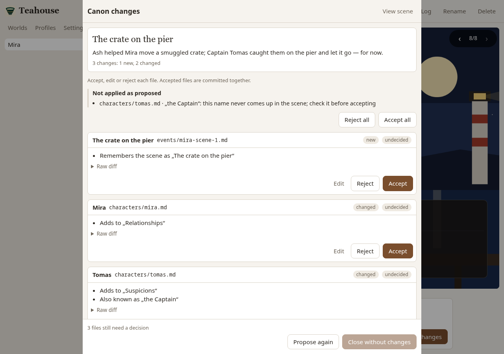
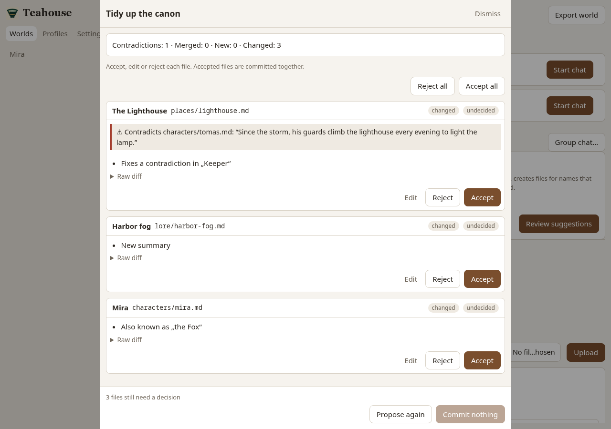

# How Teahouse works

This page explains Teahouse as you meet it while playing: chats and scenes, whose turn it is, how the story stays in the model's memory, and how the world learns from what you play. You don't need any of it to start; it's here for when you wonder why something happens.

## Worlds, chats and scenes

A **world** holds everything that stays: the setting, the characters, places, lore, and a record of past events. You can have several worlds, and each is a folder of files (see [Worlds](worlds.md)).

A **chat** is one story in a world, with you and one or more of its characters. A chat is made of **scenes**. A scene is what you'd call a scene in a book or a play: one stretch of time in one place, like "the crate on the pier at night".

You end a scene yourself, with **End scene**. Then you start the next one: write a few words about what happens next, and Teahouse proposes an opening and who is there. You can change both before you start.

Why scenes? A long chat slowly pushes its beginning out of what the model can see, so it forgets. Scenes give Teahouse a natural point to write down what matters, so the next scene starts from a clean page that still knows the story.

## Turns: who speaks next

Every reply is one character's turn. Above the text field you pick who takes the next one: a character in the scene, the **narrator**, who only describes what happens around the characters, or someone else from the world, who then joins the scene. You can also tap a character on the stage.

Leave the text field empty and press **Continue** to let the next character act without you writing anything.

If the model starts writing your lines, or another character's, Teahouse cuts the reply there. Each character only speaks in their own turn.

## The novel view

The novel view shows a reply the way a visual novel would: the background, the characters who are present in the mood of their last line, and the text in a box under the name of whoever is speaking. Click, Space or Enter read on, the arrow keys step between messages, and **Log** shows the whole scene as text.

**Branch from here** (in the ⋯ menu on an earlier page) takes the story back to that message. Your next message starts a new branch, and what came after stays one ‹ › switch away.

<details>
<summary>How replies are marked up</summary>

The model answers in a small tag format, which the view reads while the reply streams in:

```
<bg id="harbor-night"/>
<narration>Fog rolls in off the water.</narration>
<say who="mira" mood="neutral">You came alone. Good.</say>
<leave who="tomas"/>
```

`bg` changes the background, `narration` is description, `say` is one character's speech with a mood that picks their image, and `leave` takes a character off the stage. Images and backgrounds are uploaded in the world, each with a label such as `neutral` or `amused`.

</details>

## Memory while a scene runs

A model can only read so much at once. Teahouse fills that space with three things: the world's files that matter right now, a summary of the scene so far, and the latest messages word for word.

**Which world files?** The world itself, your persona, and the characters who are present always go in. Then the last two events of this chat, then any file whose name, alias or tag comes up in the recent story, then older events. If they don't all fit, files are shortened to their summary, and the oldest events go first.

This is why **aliases** matter: if Mira is also called "the Fox", give her file that alias, and she'll be found when someone says "the Fox".

**The scene summary** (Active Memory) appears only in long scenes. After each reply Teahouse checks how long the scene has become. Once it would no longer fit, a summary of the older part is written in the background, and from then on the model reads that summary plus the recent messages. The scene's opening and the last three turns always stay word for word.

Each of these jobs (writing replies, summarizing, updating the world, proposing openings) can use its own model under **Settings**. A small, fast model is often enough for the summary.

## Ending a scene: the world learns

When you end a scene **with canon**, Teahouse asks the model what the world should remember. It reads the scene and the files the scene mentions, and proposes changes:

- a new event file that records what happened,
- additions to the files of characters, places and lore,
- new aliases, when the scene called someone by another name.

<p align="center"></p>

The review sheet starts with what the world will remember: the scene's title and summary. Below it, each file says in words what changes ("Adds to „Relationships“"); **Raw diff** shows the exact text. You accept, edit or reject each file, and the accepted ones are saved together as one change in the world's history.

The model can only add to a file it hasn't read in full; it can't rewrite or delete what it didn't see. When it proposes something that looks doubtful, such as an alias the scene never uses, the review lists it under **Not applied as proposed**.

If you edited a file while the review waited, Teahouse merges both changes. Where they collide, the file shows both versions and waits until you've picked.

End a scene **without canon** for side scenes that shouldn't change the world.

## Tidying up the world

Over many scenes, a world collects small inconsistencies. **Tidy up the canon** on the world's overview goes over the whole world and suggests fixes:

- summaries that no longer match their file,
- contradictions between two files,
- duplicate files about the same person, place or thing,
- new files for names that come up in several events but have none,
- aliases and tags for files the events call by another name.

<p align="center"></p>

You review the suggestions in the same sheet as a scene's changes. A fixed contradiction shows what the other file says, so you can judge which side is right. When two character files are merged, the other one's name becomes an alias, and its chats move over to the character that stays.

Events are never changed: they are the record of what happened in play. Nothing changes until you commit, even if you turned off the review for scenes.
