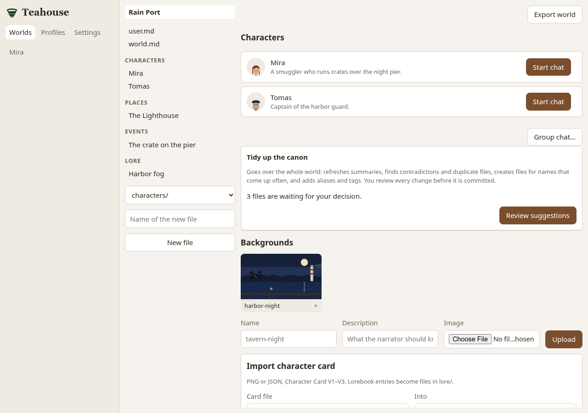

# Worlds

A world is everything that stays between scenes: the setting, the characters, places, lore, and the events you've played. Teahouse keeps it as a folder of Markdown files, so it's never locked inside the app.

<p align="center"></p>

## The files of a world

Each world is a folder under `<data>/worlds/` with its own Git repository:

```
rain-port/
  world.md        the setting, its ground rules and tone
  user.md         what the world knows about you (your persona)
  characters/     one file per character
  places/         locations
  events/         one file per scene that ended with canon
  lore/           everything else: history, customs, factions
  assets/         images (not in Git)
```

Every file starts with a few fields between `---` lines, followed by ordinary Markdown:

```markdown
---
type: character
name: Mira
tags: [smuggler, pier]
aliases: [the Fox]
summary: A smuggler who runs crates over the night pier.
greetings:
  - Mira looks up from her crate. "You're the new one."
---

# Mira

Mira grew up on the docks and knows every plank of the night pier.

## Personality

Dry, patient, and hard to rattle.
```

| Field | What it's for |
|---|---|
| `name` | How the file is shown, and the first name Teahouse looks for in the story |
| `aliases` | Other names for the same thing: nicknames, titles, "her sister". When one comes up in the story, the file is brought in |
| `tags` | Keywords that bring the file in, like aliases, but for topics (`fog`, `smuggling`) |
| `summary` | One to three sentences. Used instead of the full text when space is short, so keep it current |
| `greetings` | Characters only: the opening lines you can start a chat with |
| `enabled: false` | Leaves a file out of the story without deleting it |

Event files also carry `chat`, `scene` and `order`, which Teahouse sets itself.

> [!TIP]
> Teahouse finds files by their name, aliases and tags, not by guessing. If a character is often called something else, add that as an alias. After each scene, Teahouse proposes aliases it noticed, and **Tidy up the canon** looks for more.

## Editing

Select a file on the world page to edit it. Every save is a commit, so the world has a full history and nothing is lost.

You can also edit the folder directly, for example with [Obsidian](https://obsidian.md) or any text editor. Teahouse notices the change and commits it a couple of seconds later. Links between files can use wikilinks such as `[[mira]]`, which Obsidian understands.

If a file changes while you're editing it in Teahouse (a scene's canon, an edit in Obsidian), saving won't overwrite it silently: Teahouse shows the file as it is now against your version, and you discard your edit or save yours anyway.

## Images and backgrounds

Characters get images per mood. Open a character file and upload images, each with a label such as `neutral`, `amused` or `angry`. The novel view shows the character with the image that matches the mood of their line, and falls back to `neutral`.

Backgrounds belong to the world. Upload them on the world's overview with a short description; the model reads the descriptions to pick a background for the scene. `defaultBackground:` in `world.md` sets the one shown before the model picks.

A character's name badge can get its own color with `color:` in the character file. Colors and fonts of the whole view can be changed per world, see [Theming](theming.md).

## Character cards

**Import character card** takes SillyTavern-style cards (PNG or JSON, V1 to V3) into a new or an existing world. The card becomes a file in `characters/`, each lorebook entry a file in `lore/`, and the card image the character's default image. See [Coming from SillyTavern](sillytavern.md) for what carries over.

## Export and sharing

**Export world** on the world overview downloads a `.teahouse.tar.gz` with the world's files, images and chats. **Import world** on the worlds page restores it with a fresh history. If the world already exists on the server, the import becomes a copy.

Profiles, API keys and the world's Git history are never part of an export.
